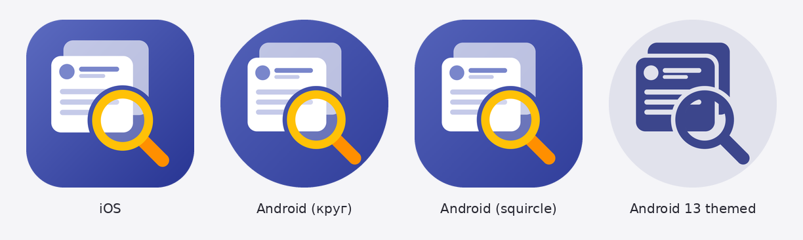

# СРС 9 — Launcher Icon, Unit Test, Widget Test

Проект: **Post Explorer** (из СРС 8) — просмотр, поиск и создание постов JSONPlaceholder.
Все изменения и тесты сделаны на основе этого приложения, а не на примерах из методички.

## Как проверить

```bash
flutter pub get
dart run flutter_launcher_icons      # генерирует иконки Android и iOS
flutter test                         # запускает все тесты
flutter run                          # проверить иконку на эмуляторе/телефоне
```

---

## Задание 1. Собственная Launcher Icon

**Идея иконки:** карточка поста (аватар автора + строки текста) поверх ленты и жёлтая лупа —
приложение показывает посты и ищет по ним. Цвет фона — индиго, как `colorSchemeSeed: Colors.indigo` в теме приложения.



Иконка нарисована скриптом `tool/make_icon.py` (Python + Pillow), исходники лежат в `assets/icon/`:

| Файл | Для чего |
|------|----------|
| `app_icon.png` | Основная иконка 1024×1024 (iOS и старые Android) |
| `app_icon_background.png` | Фон Adaptive Icon (градиент индиго) |
| `app_icon_foreground.png` | Передний слой Adaptive Icon (рисунок на прозрачном фоне) |
| `app_icon_monochrome.png` | Тематический значок Android 13+ (белый силуэт) |

Пакет подключён командой `flutter pub add dev:flutter_launcher_icons`, настройка — в конце `pubspec.yaml`:

```yaml
flutter_launcher_icons:
  android: true
  ios: true
  image_path: "assets/icon/app_icon.png"
  min_sdk_android: 21
  adaptive_icon_background: "assets/icon/app_icon_background.png"
  adaptive_icon_foreground: "assets/icon/app_icon_foreground.png"
  adaptive_icon_monochrome: "assets/icon/app_icon_monochrome.png"
  remove_alpha_ios: true
```

* **Adaptive Icon (доп. задание 1):** на Android 8+ фон и рисунок — отдельные слои, лаунчер сам
  обрезает их кругом, скруглённым квадратом и т. д. Рисунок стоит в «безопасной зоне», поэтому не обрезается.
* `remove_alpha_ios: true` — App Store не принимает иконки с прозрачностью.
* В `AndroidManifest.xml` подпись под иконкой изменена с `post_explorer` на **Post Explorer**.

После `dart run flutter_launcher_icons` появляются файлы в `android/app/src/main/res/mipmap-*`,
`mipmap-anydpi-v26/ic_launcher.xml` (adaptive) и `ios/Runner/Assets.xcassets/AppIcon.appiconset`.

📸 *Скриншот главного экрана эмулятора с новой иконкой:* `screenshots/launcher.png`

---

## Задание 2. Unit Test — логика приложения (34 теста)

Папка `test/unit/`. Интернет не нужен: используется `FakePostApi`, кэш — в памяти.

### `post_validation_test.dart` — валидация формы «Новый пост» (9 тестов)
Функции `validateTitle` (5–100 символов) и `validateBody` (10–1000 символов) с экрана `CreatePostScreen`.

| Проверка | Ожидаемый результат |
|----------|---------------------|
| Нормальный заголовок / текст | `null` (ошибки нет) |
| `null`, пустая строка, одни пробелы | «Введите заголовок» / «Введите текст поста» |
| Граница снизу: 4 и 5 символов (9 и 10 для текста) | ошибка / ок |
| Граница сверху: 100 и 101 символ (1000 и 1001) | ок / ошибка |
| `'   abcd   '` — пробелы по краям | «Минимум 5 символов» (пробелы не считаются) |

### `filter_posts_test.dart` — поиск, фильтр и сортировка (8 тестов)
Функция `filterPosts()` из `posts_provider.dart`: без фильтров (сортировка по id), фильтр по автору,
поиск без учёта регистра, пробелы в запросе, автор + поиск вместе, сортировка по убыванию,
пустой результат, исходный список не меняется.

### `app_exception_test.dart` — понятные сообщения об ошибках (10 тестов)
`AppException.from()`: таймауты → «Сервер долго не отвечает», нет сети → «Нет подключения к интернету»,
`SocketException` внутри Dio, 404, 400, 500/503, неверный тип поля в JSON → `parse`,
`FormatException`, отменённый запрос, готовая `AppException` не пересоздаётся.

### `posts_provider_logic_test.dart` — состояние экрана списка (7 тестов)
Статусы `success` / `error` / `empty`, пагинация останавливается на последней странице
(лишний запрос не отправляется), ошибка подгрузки не стирает список и «Повторить» догружает страницу,
локальный пост показывается первым, `toggleSort` и `resetFilters`.

### Пример теста

```dart
test('граница снизу: 4 символа — ошибка, 5 символов — ок', () {
  expect(validateTitle('abcd'), 'Минимум 5 символов');
  expect(validateTitle('abcde'), isNull);
});
```

`test()` описывает один тест, `expect(фактическое, ожидаемое)` сравнивает результат функции с ожидаемым.

---

## Задание 3. Widget Test — реальные экраны (12 тестов)

Папка `test/widget/`. Запускается **настоящее** приложение `PostExplorerApp` с теми же Provider'ами, что в `main()`,
только API заменён на `FakePostApi` (`test_app.dart`).

### `posts_screen_test.dart` — главный экран (5 тестов)

| Тест | Что проверяется |
|------|-----------------|
| Отображение экрана | заголовок «Post Explorer» в AppBar, поле поиска и подсказка, фильтр «Автор: Все посты», кнопки сортировки и сброса, кнопка «+», посты загружены |
| Поиск и сброс | ввод «flutter» → остался 1 пост; «kotlin» → «ничего не найдено»; «Сбросить фильтры» → поле очищено, посты вернулись |
| Сортировка | иконка ↑ меняется на ↓, пост 10 оказывается выше поста 9 |
| Фильтр по автору | выбор «2. Ervin» в выпадающем списке → только посты автора 2 |
| Нет интернета | экран ошибки с текстом и кнопкой «Повторить» → после нажатия появляются посты; кнопка перезагрузки авторов исчезает после нажатия |

### `create_post_screen_test.dart` — экран «Новый пост» (5 тестов)

| Тест | Что проверяется |
|------|-----------------|
| Отображение формы | заголовок «Новый пост», 2 поля, выбор автора, активная кнопка «Отправить» |
| Пустая форма | после нажатия появляются 3 ошибки, запрос не уходит |
| Короткий ввод (некорректные данные) | «Минимум 5 символов», «Минимум 10 символов» |
| Корректная форма | карточка «Ответ сервера» с `id: 101`, пометка «создан локально», поля очищены, пост попал в список |
| Ошибка сервера 500 | текст ошибки, кнопка снова активна, введённый текст не потерян |

### `navigation_test.dart` — переходы между экранами (2 теста, доп. задание 4)

1. Нажатие на пост → экран деталей (заголовок, текст, автор, комментарии) → «Назад» → снова список.
2. Кнопка «+» → форма → отправка → «Назад» → новый пост **вверху списка** с пометкой «создан локально» →
   открытие этого поста → пояснение, что он создан локально.

Это проверяет взаимодействие нескольких элементов и экранов (доп. задание 3).

### Пример теста

```dart
testWidgets('Кнопка сортировки меняет иконку и порядок постов', (tester) async {
  await pumpPostExplorer(tester, FakePostApi());

  expect(find.byIcon(Icons.arrow_upward), findsOneWidget);
  await tester.tap(find.byTooltip('Сортировка по ID'));
  await tester.pump();

  expect(find.byIcon(Icons.arrow_downward), findsOneWidget);
  expect(top('Post number 10'), lessThan(top('Post number 9')));
});
```

`testWidgets()` создаёт тестовую среду с `tester`; `pumpWidget` рисует экран, `tap` нажимает,
`pump` / `pumpAndSettle` перерисовывают экран после действия, `find` ищет виджеты.

---

## Задание 4. Запуск всех тестов

```bash
flutter test
```

Запускаются новые тесты СРС 9 (`test/unit`, `test/widget`) и тесты из СРС 8 (`test/*.dart`).
Сохранить отчёт: `flutter test > test_report.txt`.

📸 *Скриншот вывода `flutter test` («All tests passed!»):* `screenshots/flutter_test.png`

| Требование | Сделано |
|------------|---------|
| Своя Launcher Icon | ✅ + Adaptive Icon + Android 13 themed |
| flutter_launcher_icons | ✅ |
| Минимум 5 Unit Test | ✅ 34 |
| Минимум 3 Widget Test | ✅ 12 |
| Некорректные входные данные | ✅ валидация, неверный JSON, ошибки сети/сервера |
| Взаимодействие нескольких элементов | ✅ поиск + сброс, форма + список |
| Переход между экранами | ✅ `navigation_test.dart` |

---

## Контрольные вопросы

1. **Что такое Launcher Icon?** — Иконка приложения на главном экране и в списке приложений.
   По ней пользователь находит и запускает приложение.
2. **Для чего используется пакет flutter_launcher_icons?** — Он из одной картинки автоматически
   создаёт иконки всех нужных размеров для Android (mipmap-hdpi … xxxhdpi, adaptive icon)
   и iOS (AppIcon.appiconset) и прописывает их в проект. Вручную пришлось бы делать десятки файлов.
3. **В каком файле настраивается генерация иконки?** — В `pubspec.yaml`, раздел `flutter_launcher_icons:`
   (можно и в отдельном `flutter_launcher_icons.yaml`).
4. **Что такое Unit Test?** — Проверка отдельной функции, метода или класса без интерфейса.
   Например, `validateTitle('abcd')` должна вернуть «Минимум 5 символов».
5. **Чем Unit Test отличается от Widget Test?** — Unit Test проверяет логику (вход → результат),
   работает быстро и не рисует экран. Widget Test строит виджеты в тестовой среде и проверяет
   интерфейс: что текст и кнопки видны, что после нажатия экран меняется.
6. **Для чего используется функция expect()?** — Сравнивает фактический результат с ожидаемым
   (`expect(actual, matcher)`). Если не совпало — тест падает и показывает, что ожидалось и что получилось.
7. **Какую роль выполняет test()?** — Объявляет один unit-тест: название (что проверяем) и код проверки.
   Тесты можно объединять в `group()`.
8. **Для чего используется testWidgets()?** — Объявляет widget-тест. Даёт объект `WidgetTester`,
   через который можно нарисовать виджет (`pumpWidget`), нажать (`tap`), ввести текст (`enterText`)
   и перерисовать экран (`pump`, `pumpAndSettle`).
9. **Что делает команда flutter test?** — Находит в папке `test/` все файлы `*_test.dart`, запускает их
   и выводит результат: сколько тестов прошло и какие упали.
10. **Почему важно тестировать приложение до публикации?** — Тесты находят ошибки до того, как их увидят
    пользователи; после любых изменений можно за секунды убедиться, что старый функционал не сломался;
    исправить ошибку до релиза дешевле, чем после (плохие отзывы, повторная проверка в магазине).
